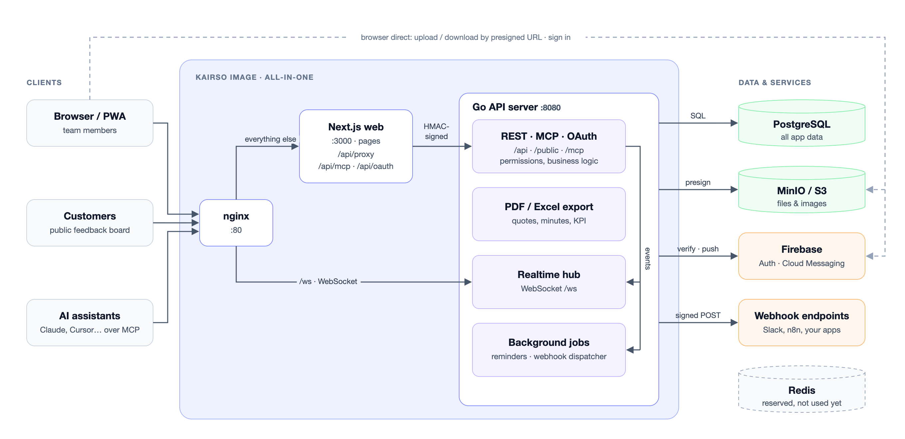

# Kairso

**Kairso** is an open-source platform for teams to manage workspaces, projects, tasks, KPIs, attendance, workflows, meeting notes and quotes, with realtime updates and multilingual (vi/en) notifications.

- 💻 Source: **https://github.com/alexcao194/kairso**
- 🌐 Website & docs: **https://kairso.com** ([Install & self-host guide](https://kairso.com/install))
- 🚀 Hosted app: **https://app.kairso.com**
- 🐳 Image: **[`alexcao194/kairso`](https://hub.docker.com/r/alexcao194/kairso)** — all-in-one (web + API), multi-arch `amd64` + `arm64`

## Architecture



<sub>Source: [`docs/architecture.svg`](docs/architecture.svg). After editing it, re-render the PNG with headless Chrome:
`chrome --headless --force-device-scale-factor=2 --window-size=1360,660 --screenshot="$PWD/docs/architecture.png" "file://$PWD/docs/architecture.svg"`</sub>

- **One entry point.** nginx sends WebSocket traffic (`/ws`) straight to the API and everything else to Next.js. The browser never calls the API directly: Next.js forwards `/api/proxy/*` to the API and signs each request with an HMAC `X-App-Token`.
- **Auth.** Users sign in with Firebase; the API verifies the Firebase ID token once and issues its own JWT. AI assistants use a personal API key (`ksk_…`) or an OAuth token, and every MCP tool runs through the same REST handlers, so they get exactly the user's permissions.
- **Realtime.** Every change is published as an event to both the hub, which pushes it to open WebSockets (the web refreshes the matching React Query cache), and the webhook dispatcher. Notifications are also sent to phones and browsers through Firebase Cloud Messaging.
- **Files.** The API hands out presigned URLs; files go between the browser and MinIO/S3 without passing through the API.
- **Redis** is part of the stack and its settings are required, but no code uses it yet.

## Repository layout

| Path | What it is |
|---|---|
| [`server/`](server) | Go API server: REST API, realtime WebSocket hub, migrations ([README](server/README.md)) |
| [`web/`](web) | Next.js web app, with a signing proxy to the API ([README](web/README.md)) |
| [`deploy/selfhost/`](deploy/selfhost) | The `docker-compose.yml` and `.env.example` self-hosters copy |
| [`deploy/image/`](deploy/image) | Entrypoint and nginx config of the all-in-one image (built from the root `Dockerfile`) |
| [`deploy/dockerhub/`](deploy/dockerhub) | Docker Hub overview page |

Both apps are versioned together: a `v*` tag builds and deploys both, and publishes one image, `kairso`, with that version.

## Self-host

Self-hosting uses the prebuilt image from Docker Hub; no need to clone this repo. Follow the guide on [Docker Hub](https://hub.docker.com/r/alexcao194/kairso) or at https://kairso.com/install: one `docker-compose.yml`, one `.env`, then `docker compose up -d`.

This repository is for developing Kairso.

## Develop from source

Requires Go 1.25+, Node.js 20+, Docker and a Firebase project.

```bash
make server-dev      # backend stack in Docker (PostgreSQL, Redis, MinIO, API with hot reload)
make web-install     # npm install in web/
make web-dev         # Next.js dev server on :3000
make api             # after changing API handlers: regenerate Swagger, then the web API client
```

See each app's README for environment variables and details.

## Contributing

Bug reports and feature ideas go to [GitHub Issues](https://github.com/alexcao194/kairso/issues); pull requests are welcome. See [server/CONTRIBUTING.md](server/CONTRIBUTING.md) for conventions.
